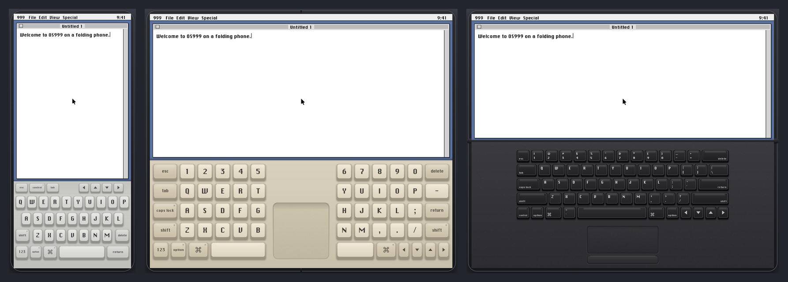
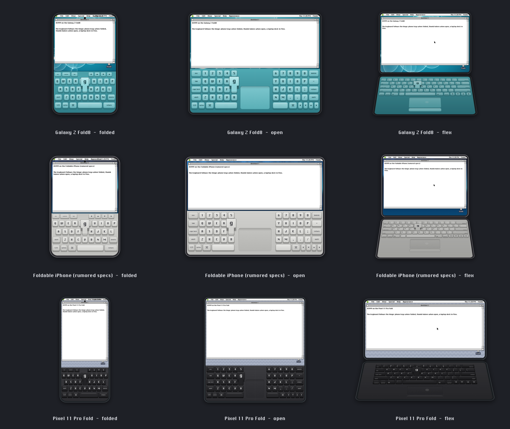
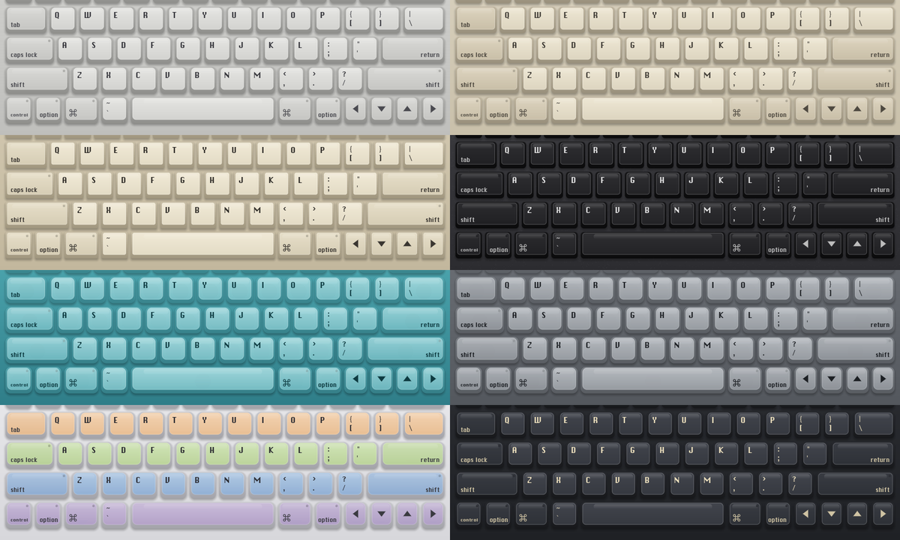

# OS999 keyboards and trackpads

On-screen keyboards and trackpads for OS999 on folding phones, plus a better
experience for people who bring a Bluetooth keyboard. Everything here is
original C11: the core has no SDL, and there's a thin SDL2 layer on top. It
draws into the desktop's own `Fb`, so it never needs a texture or a GPU path
of its own.



## Three postures, one muscle memory

| Posture | When | What you get |
|---|---|---|
| **Folded** (`KBD_COVER`) | Phone closed, cover screen | Phone-width keyboard. Command sits beside the space bar and Option beside Command, as on every desk Mac keyboard. An accessory strip gives you esc, control, tab and the four arrow keys, because Finder and SimpleText users steer with arrows. |
| **Open** (`KBD_OPEN`) | Unfolded flat, both halves | **Split**: two thumb halves at the edges with a number row, and a thumb trackpad in the gutter. No key sits on the crease. **Unsplit**: the full 15-unit desk layout. |
| **Flex** (`KBD_FLEX`) | Half-folded like a laptop | The bottom half turns into a laptop deck: the full layout pushed back, then a trackpad with **one wide button** centered in front, the way old portables laid it out. Nothing sits on the fold. |

Switching between Open and Flex morphs every key from where it was to where
it belongs. The keys move outward from the middle with a slight stagger, so
the keyboard looks like it unfolds. The deck edge and the trackpad move with
it.

Turning a book-style foldable on its side for Flex calls `kbd_rotate`. The
keys start exactly where they were, rotated with the glass, then stream onto
the laptop deck.

## On real foldables



`tools/showcase` renders the real OS999 desktop (`session_paint`) with this
keyboard at each phone's actual panel resolution:

- Galaxy Z Fold8: cover 1248×1972, inner 2448×1848
- Pixel 11 Pro Fold: cover 1080×2342, inner 2076×2152
- Apple's foldable iPhone: cover 1422×2088, inner 2713×1920. It's
  unannounced, so these are the widely reported leaked figures.

It also directs a 1080p60 film, with the synthesized switch sounds as its
soundtrack:

1. Typing on the cover screen, an accent menu, a layer flip, and space-bar
   tracking.
2. Unfolding to split thumbs.
3. The split halves morphing into the desk layout and back.
4. Turning the phone into Flex, then the clickpad's click and force click.
5. A lineup of all three phones.

To build and render it, run `sh tools/showcase/build.sh`. This also converts
wallpapers into `../build/wallpapers`.

## Typing that feels like the old keyboards

- **Option shows its layer on every cap**, the way Key Caps did. Dead keys
  (Option-e, -\`, -i, -u, -n) get an outline. Option-e then e gives é, and a
  small tag shows which accent is waiting. Delete cancels it.
- **The legends match the old desk keyboards.** Letters print top-left, the
  shifted symbol sits over the digit, and modifiers are lowercase words
  (`shift`, `option`, `control`, `caps lock`, `return`). Command gets a ⌘
  drawn from vectors. The Apple logo never appears: Shift-Option-K types
  nothing.
- **Caps lock stays down.** On the full layouts the caps lock key latches
  half-depressed with a lit LED, like the physical latching key. On the phone
  layouts, tap shift twice.
- **Modifiers work two ways.** Hold one like a real key, or tap it to latch
  for the next keystroke. If you type while holding a modifier, it doesn't
  also latch.
- Character keys commit on lift, so you can **slide to the key you meant**.
  When a second thumb lands, the first key commits immediately, so fast
  two-thumb typing never drops a letter.
- **Long-press** a key to get its alternates (à á â ä æ ã å, “ ”, € £ ¥…) in
  a menu styled like OS 8's.
- **Delete** repeats at the classic Keyboard control panel defaults (500 ms
  delay, 83 ms rate). After a dozen repeats it deletes whole words
  (Option-Delete).
- **Two spaces after a word type a period**, the one phone habit worth
  keeping.
- Swipe down from the top row to put the keyboard away.

## Trackpads

The pads aim to feel like a modern Mac trackpad.

**Pointer**

- A 1€ filter removes the pixel of noise every touch panel adds, without
  slowing a fast flick. A resting finger moves the pointer less than a third
  as much as the raw noise would.
- Speed is measured from real timestamps, so the same swipe gives the same
  pointer travel at 60, 120 or 240 Hz (within 1% in the tests).
- Acceleration follows the shape of a Mac trackpad's curve. On the Flex pad,
  a 100 px finger stroke moves the pointer about 190 px when slow and about
  400 px when flicked.
- Motion stays sub-pixel all the way to the host.

**Clickpad**

On panels that report pressure, the pad works like Force Touch:

- Press anywhere to click and press deeper to force click (`KBD_EV_FORCE`).
- The press gives a full haptic, the release a lighter, crisper one. The
  release threshold sits well below the click threshold, so a click never
  chatters.
- Light, medium and firm settings match the Mac's.
- The pad visibly gives while pressed and rings on a force click.

On panels without pressure, the pad uses tap to click.

| Gesture | Result |
|---|---|
| One finger | Pointer |
| Tap | Click, with a light haptic |
| Tap, then touch and move | Drag |
| Press (pressure panels) | Click: haptic on the way down and on the way up |
| Press deeper | Force click |
| Two fingers | Scroll. Locks to an axis when the motion is clearly vertical or horizontal |
| Flick with two fingers | Momentum from the real flick speed. A resting finger stops it; pausing before lifting cancels it |
| Two-finger tap | **Control-click**, which is how OS 8 and 9 opened contextual menus |
| Three fingers (option) | Drag, as in the macOS accessibility setting |
| Wide button under the Flex pad | Click. Hold it and move on the pad to drag |
| **Hold the space bar** (any layout) | The whole keyboard becomes a trackpad. A second finger clicks; pressing harder clicks too |

## Haptics

Every interaction has a matching haptic type: key, wide key, modifier latch,
selection detent, tap, click, release, force click and trackpad mode. Each
type has a fixed intensity, sharpness and duration, so the feel stays the
same on every device.

On a Mac with a Force Touch trackpad, the simulator plays them through
AppKit, so you can feel the keyboard and clickpad while your finger is on the
trackpad. Other SDL hosts use any rumble-capable haptic device. Native phone
hosts should map the types to Android's `VibrationEffect.Composition`
primitives or iOS Core Haptics; [docs/HAPTICS.md](docs/HAPTICS.md) has the
table.

## Bluetooth keyboards

- The first physical keystroke slides the on-screen keyboard away. A slim
  Platinum strip takes its place, with live control/option/⌘/shift/caps lock
  indicators and a **Keyboard** button that brings the touch keys back.
- **Hold ⌘** for 0.7 s and a Platinum window lists the shortcuts the host
  registered with `kbd_set_shortcuts`, like holding Command on an iPad.
- **PC modifier order:** on a Windows-layout keyboard, Alt sits where Command
  belongs. With `pc_modifiers` on, Alt becomes Command and the Windows key
  becomes Option, so the key next to the space bar is always Command. The SDL
  layer rewrites the event in place, so the desktop never knows.
- **Click along** (off by default) plays the skin's switch sound for hardware
  keys too.

## Skins



| Skin | Look | Switch sound |
|---|---|---|
| Platinum | Light gray caps, pinstriped case | Rubber dome |
| Desk Beige | Warm beige heavy desk board | Alps-style tactile clack |
| Original 128 | Squarer caps, darker case | Mitsumi-style bright click |
| Portable Black | Low black caps on a speckled deck | Scissor (laptop) |
| Teal Translucent | See-through caps; the domes show through | Hollow rubber dome |
| Graphite | Smoky translucent caps | Rubber dome |
| Five Flavors | White caps tinted row by row in fruit colors | Rubber dome |
| Midnight | Dark platinum, warm legends, amber LEDs | Alps-style |

The skins suggest eras through color, cap shape and sound. They use no logos,
trade dress or copied artwork.

## Sound

`kbd_synth.c` builds each keystroke from the physical events that make the
real sound:

- the leaf or click jacket snapping, as a filtered noise burst
- the stem bottoming out a few milliseconds later, which excites the keycap
  and case resonances (damped modes)
- on release, the stem hitting the top housing (the clack that gives heavy
  desk boards their character)

Wide keys add the stabilizer wire and a lower, longer case resonance.

Each switch family has its own travel time, resonances and damping. Each
sound has four seeded variants. Every press also gets a small pitch and level
offset, and stereo position from where the key sits on screen, so fast typing
never sounds like one sample repeated. The mixer has 24 voices and steals the
oldest when they're all busy. It pans at equal power and ends in a soft knee
so a pile-up can't clip. Audio runs at 48 kHz with a 256-frame callback
(about 5 ms).

`make audition` types a sentence on each switch family into
`build/audition/*.wav` so you can compare them.

## Build and run

From this folder (needs SDL2 and FreeType; `brew install sdl2 freetype`). The
build file is `keyboard.mk`: run `mv keyboard.mk Makefile` once, or add
`-f keyboard.mk` to each command.

```bash
make test       # 64,115 headless checks (keyboard, trackpad, haptics), no SDL
make test-sdl   # the SDL event path, pressure and haptics, with SDL's dummy driver
make run        # the folding-phone simulator
make shots      # every posture and skin to build/shots/*.png
make audition   # build/audition/typing-{dome,alps,mitsumi,scissor}.wav
```

In the simulator, the mouse is a finger, Shift-drag is two fingers, and a
right-click is a two-finger tap. Hold F8 (press) or F9 (force press) while
touching the pad to try the clickpad; on a Mac keyboard that's fn-F8 and
fn-F9. The panel shows which haptics backend is active and names each
haptic as it fires. Typing on the Mac keyboard tests the
Bluetooth path. F1, F2 and F3 switch posture, F4 toggles split, F5 and F6
change skin, and F7 toggles sound.

Wiring it into the desktop takes about thirty lines in `src/main.c`, with no
changes to `input.c`. See [docs/INTEGRATION.md](docs/INTEGRATION.md).

## Files

| File | What it does |
|---|---|
| `include/kbd.h` | Public API (SDL-free) |
| `include/kbd_audio.h`, `src/kbd_synth.c`, `src/kbd_mixer.c` | Switch sound synthesis and mixer |
| `include/kbd_sdl.h`, `src/kbd_sdl.c` | SDL2 glue: audio device, event push, touch and hardware-key routing |
| `src/kbd_layout.c` | Postures and layouts |
| `src/kbd_keys.c` | Key table, including the classic US Option layer |
| `src/kbd_touch.c` | Typing engine |
| `src/kbd_pad.c` | Trackpads: clickpad, gestures, momentum, space-bar tracking |
| `src/kbd_motion.c` | 1€ filter, acceleration curve, haptic vocabulary |
| `src/kbd_haptics.c` | Haptic playback: AppKit Force Touch on macOS, SDL rumble elsewhere |
| `src/kbd_text.c` | Dead keys, alternates, legends |
| `src/kbd_anim.c` | Springs and morphs |
| `src/kbd_gfx.c` | Anti-aliased SDF shapes and FreeType legends |
| `src/kbd_draw.c`, `src/kbd_draw_over.c` | Caps, deck, pad, popups, hardware strip, shortcut sheet |
| `src/kbd_skin.c` | Skins |
| `demo/` | Folding-phone simulator |
| `tools/showcase/` | Real-desktop renders and the film for Fold8, Pixel and foldable iPhone |
| `tests/` | Headless and SDL checks |
| `tools/` | Screenshot, PNG and audition tools |

Every file stays under 500 lines, and `make test` enforces that.

## Status

Verified in a Linux container (gcc 13 and clang 18; the tests also pass under
AddressSanitizer and UBSan):

- all checks pass
- every posture and skin renders
- the simulator runs with SDL's dummy driver
- the macOS haptics code was type-checked against stub runtime headers only

Not yet verified:

- a build on macOS
- listening to the synthesized sounds (only their spectra were checked: no
  clipping, no DC offset, families distinct)
- feeling the haptics on any real device
- the pressure clickpad on a panel that really reports pressure
- a real touch panel or folding device
- integration into `build/OS999 Stylized.app`
