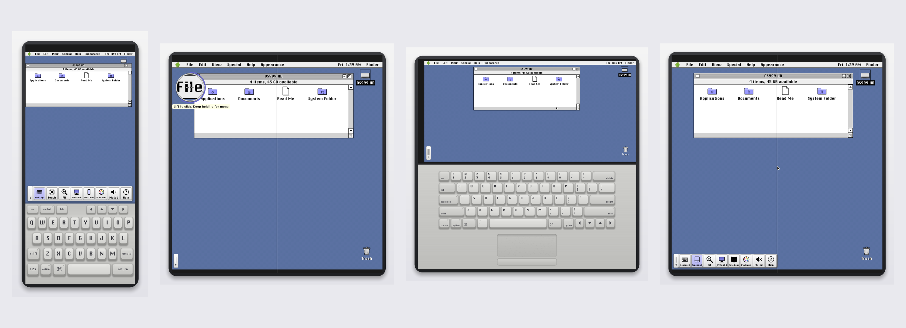

# OS999 on folding phones

The OS999 desktop on iOS and Android, built around folding phones: the cover
screen, the unfolded inner screen, and the half-folded Laptop and Book
postures. Branch `os999-mobile`, worktree `ios_android/`. The design notes are
in [`docs/MOBILE.md`](../docs/MOBILE.md).



## Layout

| Path | What it is |
|---|---|
| `include/`, `src/` | The phone shell, plain C11 with no SDL: device profiles and postures, per-posture desktop resolution, zoom and pan, window continuity, the touch model, the Control Strip, the loupe, balloons, the first-run guide, and composition. |
| `sdl/` | The SDL2 host. It's the app on iOS and Android and a folding-phone simulator on a Mac. It also holds the platform plumbing (JNI fold reports, iOS haptics and safe area). |
| `tests/` | Headless checks covering every device and posture, plus a real desktop session driven by fingers. |
| `tools/` | `mobile_shots` renders every device and posture to PNG. `mobile_icons` draws the app icons and the glyph sheet. |
| `ios/` | `Info.plist`, launch screen, asset catalog (app icon, launch mark). |
| `android/` | Gradle project: `OS999Activity` (SDLActivity), `FoldBridge` (Jetpack WindowManager), adaptive icons, splash. |
| `assets/` | Rendered screenshots (`shots/`), the glyph sheet, and the Play Store icon. |
| `CMakeLists.txt` | Builds the iOS app (Xcode generator) and the Android `libmain.so`. |
| `mobile.mk` | Tests, shots, icons and the desktop simulator. |

The keyboards come from `../keyboard`, which is untracked in the main tree.
Set `KBD_DIR` or `OS999_KEYBOARD` if they move.

## Commands (from the repository root)

```sh
make -f mobile/mobile.mk OUT=build/mobile-mac test   # headless checks (OUT keeps Mac and Linux builds apart)
make -f mobile/mobile.mk shots       # mobile/assets/shots/*.png
make -f mobile/mobile.mk icons       # app icons, launch mark, glyph sheet
make -f mobile/mobile.mk run-sim DEVICE=galaxy-z-fold8
sh mobile/scripts/fetch-deps.sh      # SDL2 2.32.10 + FreeType 2.15.0 into build/deps
sh mobile/scripts/ios-sim.sh "iPhone Air"
sh mobile/scripts/install-android-sdk.sh   # JDK 17, SDK 36, NDK r28c, CMake, Gradle wrapper
cd mobile/android && JAVA_HOME=$(brew --prefix openjdk@17)/libexec/openjdk.jdk/Contents/Home ./gradlew :app:assembleDebug
```

Simulator keys: **F5** cycles the posture, **F6** the device, **F7** a
Bluetooth keyboard. Drag with the mouse to use one finger, **Option**-drag to
pinch, and **Shift-Option**-drag to use two fingers side by side. **F8** makes
the mouse a pointer, as with a keyboard case's trackpad. Then right-click opens
the contextual menu, the wheel scrolls, and **⌘** or **Control** with the
wheel zooms, as a trackpad pinch does on a device. Keyboard and pointer
support on each platform is in `docs/MOBILE.md`, section 8.
